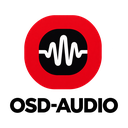
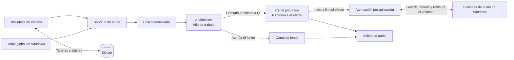
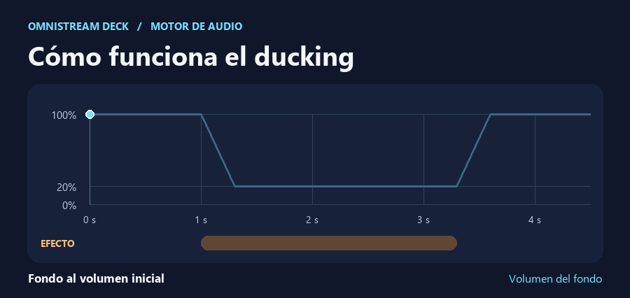
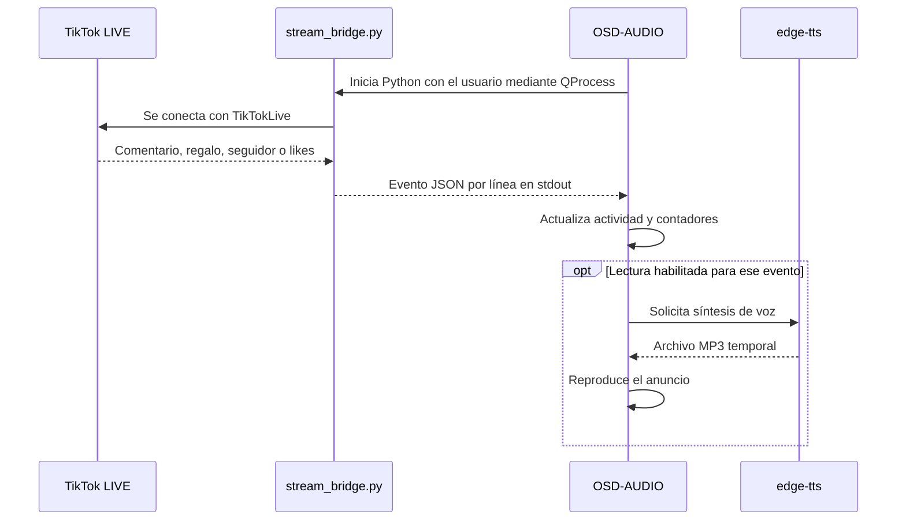

<p align="center">
  
</p>

<h1 align="center">OmniStream Deck</h1>

<p align="center">
  Panel de efectos de sonido y monitor de TikTok LIVE para Windows.
</p>

<p align="center">
  <strong>OSD-AUDIO · Audio para creadores de contenido</strong>
</p>

[Cómo funciona](#cómo-funciona) · [Instalación](#instalación-en-windows) · [Uso](#uso-de-la-aplicación) · [Estado](#estado-del-proyecto)

OmniStream Deck reúne una biblioteca de efectos, atajos globales y un panel de actividad de TikTok LIVE. Durante una transmisión puedes lanzar un sonido sin cambiar de ventana, reducir temporalmente el volumen de otras aplicaciones y configurar qué eventos se leen en voz alta.

[Ver presentación del proyecto](https://shsecurity.github.io/OSD-AUDIO/)

## Cómo funciona

### Del atajo al altavoz



Una tarjeta guarda el nombre, la categoría, el archivo, el volumen y el atajo del efecto. Al pulsarla, el mezclador procesa la solicitud en un hilo de trabajo y encola la reproducción en el hilo de Qt, donde viven los reproductores. SQLite guarda la configuración y la ruta del audio. Conserva los archivos de sonido en su ubicación para que las tarjetas puedan reproducirlos al volver a abrir la aplicación.

### Ducking animado



La línea azul representa el volumen del fondo y la barra naranja indica cuándo suena el efecto. La gráfica ilustra el canal de fondo interno, que pasa del 100 % al 20 % con transiciones de unos 300 ms. La duración del efecto es ilustrativa. La selección de una pista para ese canal desde la ventana sigue pendiente.

En Windows, el mezclador también controla las sesiones activas de otras aplicaciones. El ajuste indica qué fracción del volumen anterior se conserva durante el efecto. Por ejemplo, si una aplicación está al 80 % en Windows y debe conservar el 25 %, su volumen baja al 20 % durante el efecto y vuelve al 80 % al terminar.

### De TikTok LIVE al panel y a la voz



## Descargar para Windows

Descarga **OSD-AUDIO-Windows-x64.zip** desde [la última versión publicada](https://github.com/ShSecurity/OSD-AUDIO/releases/latest). Extrae toda la carpeta y abre **OSD-AUDIO.exe**. El archivo ZIP incluye las bibliotecas de Qt y los complementos de audio.

Para conectar TikTok LIVE y generar voz, instala Python 3 y ejecuta:

```powershell
python -m pip install --user TikTokLive edge-tts
```

Agrega al PATH las carpetas de Python y sus Scripts para que la aplicación encuentre ambos comandos.

## Instalación en Windows

Necesitas **Git**, **CMake 3.20 o posterior**, **Ninja**, **Qt 6 para MinGW** con Qt Multimedia, una versión de **MinGW compatible con ese Qt** y **Python 3**. La compilación y la reproducción de MP3, WAV y OGG se verificaron en Windows 10 con **Qt 6.10.2 y MinGW 13.1**. Qt Core, Widgets y SQL se incluyen en Qt Base.

Desde PowerShell, en la raíz del repositorio, instala las dependencias de Python. El panel de TikTok requiere conexión a Internet, al igual que la síntesis de voz.

```powershell
python -m pip install --user TikTokLive edge-tts
$pythonScripts = python -c "import sysconfig; print(sysconfig.get_path('scripts', scheme='nt_user'))"
$env:Path = "$pythonScripts;$env:Path"
python -c "import TikTokLive"
edge-tts --version
```

Ajusta las dos rutas a tu instalación de Qt. Mantén disponible `cmake` y `ninja` en el `PATH`.

```powershell
$qt = 'C:\Qt\6.10.2\mingw_64'
$mingw = 'C:\Qt\Tools\mingw1310_64\bin'
$env:Path = "$mingw;$qt\bin;$env:Path"

cmake -S . -B build -G Ninja -DCMAKE_BUILD_TYPE=Release "-DCMAKE_PREFIX_PATH=$qt" "-DCMAKE_CXX_COMPILER=$mingw/g++.exe"
cmake --build build --parallel
& "$qt\bin\windeployqt.exe" --release --no-translations .\build\OSD-AUDIO.exe
Copy-Item .\stream_bridge.py .\build\stream_bridge.py -Force
.\build\OSD-AUDIO.exe
```

Después del despliegue, puedes abrir `build/OSD-AUDIO.exe` directamente. Para usar TikTok y la voz al abrirlo desde el Explorador, agrega las carpetas de `python.exe` y `edge-tts.exe` al `PATH` de tu usuario. La aplicación inicia el script de TikTok cuando pulsas **Conectar**.

## Uso de la aplicación

### Biblioteca y atajos

Abre **Biblioteca → Agregar efecto**, selecciona un archivo de audio y guarda la tarjeta con un nombre. Puedes asignarle un atajo para reproducirlo desde otra ventana. El botón verde **Pausar atajos** libera los atajos de la biblioteca. El botón rojo **Activar atajos** los vuelve a habilitar. Mientras están pausados, puedes seguir usando las tarjetas con el ratón.

### Volumen por aplicación

1. Pon audio en otra aplicación para que aparezca en **Biblioteca → Mezclador → Volumen por aplicación**.
2. Ajusta **Conservar global**. Cada aplicación en modo **Global** muestra y usa ese porcentaje.
3. Pulsa **Personalizado** en una aplicación para escribir un valor de **0 a 100 %**. Con **0 %** queda en silencio durante el efecto. Con **100 %** conserva todo su volumen. El valor se guarda por aplicación.
4. Dispara un efecto para comprobar la atenuación. Al terminar, o al pulsar **Detener**, se restaura el volumen anterior. Puedes volver a **Global** con un clic.

### TikTok LIVE y cierre

En **TikTok Live**, escribe el usuario de una cuenta que esté transmitiendo y pulsa **Conectar**. Usa los controles de esa pantalla para elegir qué eventos quieres escuchar y **Desconectar** para cerrar la conexión.

Al pulsar la **X**, elige **Seguir usando** para cancelar o **Cerrar aplicación** para desconectar TikTok LIVE, detener sonidos y voz, restaurar los volúmenes de otras aplicaciones y liberar los atajos.

## Arquitectura del proyecto

| Ruta | Responsabilidad |
| --- | --- |
| [src/gui/](src/gui/) | Ventana principal, biblioteca y editor de tarjetas. |
| [src/core/](src/core/) y [include/core/](include/core/) | Mezclador, canales de audio, atajos, atenuación y voz. |
| [src/network/](src/network/) y [stream_bridge.py](stream_bridge.py) | Comunicación entre la aplicación y el proceso de TikTok. |
| [include/interfaces/](include/interfaces/) e [include/utils/](include/utils/) | Interfaces abstractas y utilidades genéricas. |
| [tests/](tests/) | Casos de prueba del mezclador, la cola y la atenuación. |

- **Herencia y polimorfismo.** `PriorityChannel` y `BackgroundChannel` implementan las operaciones virtuales de `AudioChannel` con comportamiento especializado.
- **Concurrencia y plantillas.** `AudioMixer` consume solicitudes desde `ThreadSafeQueue<AudioRequest>` y despacha operaciones a Qt mediante conexiones encoladas.
- **Persistencia.** SQLite conserva las tarjetas y ajustes de voz. `QSettings` guarda el estado de los atajos y los porcentajes del mezclador. El repositorio también contiene un módulo de perfiles JSON, separado del flujo de la biblioteca.
- **Audio de Windows.** [`ApplicationDucking`](src/core/ApplicationDucking.cpp) enumera las sesiones de audio, aplica el porcentaje global o personalizado y conserva el volumen previo para restaurarlo.
- **Comunicación entre procesos.** `TikTokBridge` ejecuta el [script de la raíz](stream_bridge.py) mediante `QProcess`. El [script en bridge/](bridge/stream_bridge.py) corresponde a una versión por WebSocket.

## Estado del proyecto

| Área | Estado |
| --- | --- |
| Compilación y arranque en Windows | Verificados en la compilación local. |
| Biblioteca y atajos globales | Tarjetas persistentes y pausa de atajos desde la biblioteca. |
| Ducking | Atenuación por aplicación con ajuste global, valores personalizados y restauración de volumen verificada con sesiones de Windows. La selección de una pista para el canal interno sigue pendiente. |
| Cierre seguro | Se verificó la cancelación del cierre y la finalización de los procesos auxiliares con una prueba local. |
| TikTok LIVE y lectura de eventos | El script carga y se verificó la generación de un MP3 con `edge-tts`. Queda por validar la recepción y lectura de eventos con una transmisión activa. |
| Pruebas automatizadas | Hay casos escritos. La compilación verificada registró cero pruebas en CTest, pues el objetivo de pruebas se habilita solo cuando CMake encuentra GoogleTest. |

Para consultar los casos que reconoce tu compilación, ejecuta `ctest --test-dir build -N`. Cuando haya pruebas registradas, ejecútalas con `ctest --test-dir build --output-on-failure`.
